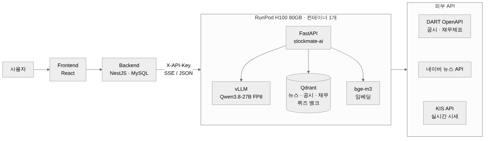

# StockMate AI

주식 투자 학습 웹 서비스 **StockMate** 의 AI 서버입니다.

- 종목을 물어보면 그 회사의 최신 뉴스, DART 공시, 실시간 시세를 찾아 근거로 붙여 답합니다.
- 사용자 수준과 틀린 문제 기록에 맞춰 투자 퀴즈를 만듭니다.
- 사이트 사용법(모의투자 규칙, 보상, 등급 등)을 물어보면 실제 사이트 기준으로 답합니다.

졸업작품으로 프론트엔드(React), 백엔드(NestJS), AI 서버 세 저장소로 나눠 진행했습니다.
이 저장소는 AI 서버이고, 설계부터 모델 선정, 서빙, 배포까지 혼자 맡았습니다.
프론트엔드는 [StockMate_Front](https://github.com/DMU-StockMate/StockMate_Front), 백엔드는 [StockMate_Back](https://github.com/DMU-StockMate/StockMate_Back) 에 있습니다.

| | |
|---|---|
| 기간 | 2026.05 ~ 2026.11 |
| API 문서 | https://dmu-stockmate.github.io/stockmate-ai/ |
| 서버 | RunPod H100 80GB 한 장, 컨테이너 하나 (vLLM + Qdrant + FastAPI) |
| 모델 | Qwen3.8-27B (FP8), 임베딩 BAAI/bge-m3 |

<br>

## 목차

1. [무엇을 하는 서버인가](#1-무엇을-하는-서버인가)
2. [구조](#2-구조)
3. [기술 스택과 선택 이유](#3-기술-스택과-선택-이유)
4. [문제 해결 기록](#4-문제-해결-기록)
5. [성능](#5-성능)
6. [실행 방법](#6-실행-방법)
7. [테스트와 측정 도구](#7-테스트와-측정-도구)
8. [디렉터리 구조](#8-디렉터리-구조)
9. [한계와 남은 일](#9-한계와-남은-일)

<br>

## 1. 무엇을 하는 서버인가

백엔드(NestJS)만 이 서버를 호출합니다. 브라우저가 직접 붙지 않고, 모든 요청에 `X-API-Key` 헤더가 필요합니다.

| 엔드포인트 | 하는 일 |
|---|---|
| `POST /chat/stream` | 채팅. SSE 로 토큰을 흘려보냄 (`meta` → `token`… → `done`) |
| `POST /chat/evaluate` | 위와 같은 경로를 타되, 검색 후보·점수·채택 여부와 LLM 에 실제로 들어간 컨텍스트를 돌려줌 (RAG 점검용) |
| `POST /quiz/generate` | 주제·수준을 받아 OX / 4지선다 문제 생성 |
| `POST /quiz/generate/prompt` | "PER 문제 3개 만들어줘" 같은 자유 문장을 분석해 출제 계획을 세우고 생성 |
| `POST /quiz/generate/review` | 사용자가 틀린 문제들을 받아, 자주 틀린 주제 위주로 새 문제 생성 |
| `GET /health` | 상태 확인 (키 없이 열림) |

### 채팅

질문 하나가 들어오면 먼저 어느 갈래로 보낼지 정합니다. LLM 을 한 번 더 부르지 않고 규칙으로만 판별해서 지연이 늘지 않습니다.

```
질문 ─┬─ 사이트 관련 단어가 있다 ──────────────→ site    : 사이트 안내서를 통째로 넣고 답변
      ├─ 종목명이 있다 ────────────────────────→ rag     : 뉴스·공시·재무·시세를 모아 답변
      ├─ 후속 질문 ("그럼 거긴 어때?")
      │    └ 직전 질문의 갈래 / 대화 속 종목을 이어받음
      └─ 나머지 ───────────────────────────────→ general : 모델 지식으로 개념 설명
```

종목명은 DART 기업 코드 목록 중 종목 코드가 있는 상장사(점검 당시 약 3,960곳)에서 찾습니다. "삼전", "하이닉스" 같은 줄임말 사전과 조사 제거("삼성전자랑" → "삼성전자")를 거친 뒤 퍼지 매칭합니다.

`rag` 갈래에서는 종목마다 네이버 뉴스, DART 공시, DART 재무제표 적재를 **동시에** 돌리고, 시세(현재가, PER/PBR/EPS)는 KIS API 로 따로 받습니다. 한 소스가 실패해도 나머지로 답합니다.

답변 수준은 사용자의 투자 등급(입문/초급/중급/고급)에 맞춥니다. 문제를 풀다가 질문하면 그 문제의 지문·선택지·해설을 함께 넘겨받아 문제 맥락에서 설명합니다.

### 퀴즈

- 카테고리는 등급별로 19개(초급 5, 중급 7, 고급 7)이고, 각 카테고리 아래 상세 주제가 있습니다.
- 생성한 문제는 그대로 내보내지 않습니다. 한국어 외 문자 혼입, 선택지 번호, 정답 위치, OX 문장 형식, 주제 이탈을 규칙으로 검사하고 걸리면 다시 만듭니다.
- 같은 세트 안에서 비슷한 문제가 나오지 않도록 문자 유사도와 임베딩 유사도(bge-m3, 코사인 0.83)를 같이 봅니다.
- 오답 기반 생성은 사용자가 실제로 골랐던 오답을 프롬프트에 넣어, 그 오해를 선택지로 다시 내고 해설에서 짚게 합니다.

<br>

## 2. 구조

<p align="center">
  
</p>

- 글로 된 자료(뉴스, 공시 본문)는 Qdrant 에 넣고 의미 검색합니다.
- 숫자(현재가, PER/PBR/EPS)는 벡터 DB 에 넣지 않고 그때그때 KIS API 로 받습니다. 숫자를 임베딩해 섞으면 검색 품질만 떨어지고, 시세는 어차피 금방 낡습니다.
- 대화 기록은 백엔드가 MySQL 에 저장하고 매 요청에 최근 대화를 실어 보냅니다. AI 서버는 상태를 들고 있지 않습니다.

<br>

## 3. 기술 스택과 선택 이유

| 영역 | 사용 |
|---|---|
| API 서버 | Python 3.11, FastAPI, uvicorn, `uv` |
| LLM 연동 | LangChain (`ChatOpenAI` / `ChatOllama`) |
| LLM | Qwen3.8-27B FP8 (vLLM) |
| 임베딩 | BAAI/bge-m3 (`sentence-transformers`) |
| 벡터 DB | Qdrant 1.18 |
| 외부 데이터 | DART OpenAPI, 네이버 검색 API(뉴스), 한국투자증권 KIS API |
| 배포 | Docker, RunPod (H100 80GB + Network Volume), Docker Hub |
| 문서 | OpenAPI → GitHub Pages (`docs/`) |

### 모델은 세 번 바꿨다

| 시기 | 모델 | 서빙 | 바꾼 이유 |
|---|---|---|---|
| 5월~ | Qwen3.5-9B | Ollama (RTX 4060 Ti 8GB) | 시작점 |
| 8월 | Qwen3.6-35B-A3B | llama.cpp, MoE 레이어 CPU 오프로드 | 8GB VRAM 으로 더 큰 모델을 돌리려고 |
| 8월 말~ | **Qwen3.8-27B** | vLLM FP8, H100 | 퀴즈의 용어 오류 |

35B-A3B 로 만든 퀴즈는 자동 검사를 12/12 통과했는데, 직접 읽어 보니 틀린 용어가 3건 있었습니다.

- "ROE 는 **당기가손익**을 자기자본으로 나눈 값" (당기순이익이 맞음)
- 주제가 시가총액인데 "**주가총액**은 주가에 발행주식 수를 곱하여…"
- 영업이익 정답 선택지가 문장으로 성립하지 않음

셋 다 문법적으로 멀쩡한 한국어라 어떤 검사 규칙에도 걸리지 않습니다. 같은 12개 케이스를 Qwen3.8-27B 로 돌리자 이런 오류가 0건이었습니다.

총 파라미터는 35B 가 27B 보다 큽니다. 차이는 토큰 하나를 만들 때 실제로 쓰는 파라미터였습니다. 35B-A3B 는 MoE 라 토큰마다 3B 만 쓰고, 27B 는 dense 라 27B 를 다 씁니다. 용어를 정확히 꺼내야 하는 작업에서는 이 차이가 그대로 드러났습니다.

더 큰 모델(GLM-5.3-Flash, DeepSeek V4 등)도 검토했지만 GPU 를 여러 장 써야 해서 예산(베타 + 발표 합쳐 30시간 미만, 10~19만 원)을 몇 배 넘었습니다. 27B 는 FP8 로 28GB 라 H100 한 장에 올라가고 KV 캐시 자리도 50GB 가 남습니다. 예산선 안쪽에 걸린 유일한 선택지였습니다.

이 과정은 유료 API 대신 오픈 웨이트 모델을 직접 서빙한다는 프로젝트 원칙 안에서 진행했습니다.

### vLLM, 그리고 컨테이너 하나

- **vLLM**: 동시 사용자 20명을 받아야 해서 연속 배칭이 필요했습니다. Ollama 는 개발할 때는 편하지만 동시 요청을 많이 받는 용도로는 맞지 않았습니다.
- **컨테이너 하나에 전부**: GPU 는 베타 테스트 날과 발표 날에만 빌립니다. 그날 파드 하나만 띄우면 공개 URL 이 나오도록 vLLM, Qdrant, FastAPI 를 한 이미지에 넣었습니다. RunPod 은 도커 안에서 도커를 못 띄우므로 Qdrant 는 정적 바이너리로 넣었습니다.
- **Network Volume**: 모델 가중치(28GB)와 Qdrant 데이터를 파드 밖 볼륨에 둡니다. 파드를 지워도 남아서 다음 기동 때 다시 받지 않습니다.
- **베이스 이미지 다이제스트 고정**: `vllm/vllm-openai:latest` 를 쓰면 발표 당일 다른 빌드가 내려와 리허설 검증이 무효가 됩니다.

<br>

## 4. 문제 해결 기록

배포하고 베타 테스트를 하면서 실제로 막혔던 것들입니다. 숫자는 전부 직접 잰 값입니다.

### 4-1. 프록시가 100초에서 연결을 끊는다

**증상** 동시 20명이 프롬프트 퀴즈를 요청하자 20건 모두 `HTTP 524` 가 떨어졌습니다. 그런데 서버 로그에는 문제 생성이 정상적으로 끝나 `퀴즈 뱅크 저장: 5개` 가 계속 찍히고 있었습니다.

**원인** RunPod 의 HTTP 프록시(Cloudflare)는 응답의 첫 바이트를 100초까지만 기다립니다. 앱이 죽은 게 아니라 프록시가 먼저 끊은 것이었습니다. 처음엔 이 제한을 80초로 잘못 알고 있었는데, 98.9초짜리 요청이 통과한 걸 보고 "80초가 아니다"라고만 결론 내렸습니다. 사실은 100초를 안 넘겨서 통과한 것이었습니다.

`--max-num-seqs` 를 올리는 건 답이 아니었습니다. 20명 × LLM 7회 × 약 1,400토큰 ≈ 196,000토큰이고, H100 한 장의 실측 처리량(1,137 tok/s)으로는 172초가 걸립니다. GPU 한 장의 처리량 자체가 상한이었습니다.

**해결** 응답이 30초를 넘기면 200 헤더를 먼저 보내고 10초마다 공백을 흘린 뒤, 마지막에 원래 JSON 을 붙입니다. JSON 은 값 앞의 공백을 무시하므로(RFC 8259) 백엔드 파싱 코드는 한 줄도 바뀌지 않습니다. (`app/core/keepalive.py`)

이 방식에서 함정이 두 개 있었습니다.

1. 첫 측정에서 "공백이 한 번도 안 왔다"고 나왔습니다. 응답이 `\x1f\x8b` 로 시작하는 걸 보고 Cloudflare 가 gzip 으로 압축하고 있다는 걸 알았습니다. 측정 스크립트가 압축된 바이트를 보고 있었던 것이고, 실제로는 박동이 정상으로 흘러가고 있었습니다. 로컬에서는 압축이 없어 이 문제가 안 보입니다.
2. 헤더를 보낸 뒤에는 상태 코드를 바꿀 수 없습니다. 처음엔 실패하면 연결을 끊어 클라이언트가 에러로 알게 하려 했는데, 직접 패킷을 떠 보니 uvicorn 이 스트림을 정상 종료해서 클라이언트는 `200 OK` 와 공백뿐인 본문을 받았습니다. 실패 신호가 하나도 없었습니다. 그래서 실패를 본문으로 알리도록 바꿨습니다.

```jsonc
{ "detail": "...", "error_type": "ValueError", "keepalive_error": true }
```

성공 응답에는 항상 `questions` 가 있으므로 그 키 유무로 판정하면 됩니다.

**결과** 동시 20명 프롬프트 퀴즈에서 524 가 0건이 됐고, 가장 오래 걸린 324초짜리 요청도 끝까지 전달됐습니다.

### 4-2. 문제 5개에 3~4분이 걸린다

**증상** 문제 생성이 2분을 넘겨 백엔드 타임아웃에 걸렸습니다.

**원인** 세 생성 경로 모두 LLM 을 순서대로 불렀습니다. 프롬프트 퀴즈 5문제면 분석 1회 + 생성 5회 + 검증 1회, 7번을 줄 세워 기다렸습니다. 코드에는 "로컬 Ollama 가 동시 요청을 못 받아서 순차로 한다"는 주석이 남아 있었는데, 서빙을 vLLM 으로 바꾼 뒤에도 주석과 코드가 그대로였습니다.

**해결**

1. 생성을 전부 동시에 돌리고, 겹치는 문제만 나중에 다시 만듭니다. 모든 문제에 미리 치르던 중복 회피 비용을 실제로 겹친 것에만 치릅니다.
2. 그랬더니 중복이 늘었습니다. 같은 주제 3문제를 따로따로 만들면 서로를 못 봐서 중복 발동률이 73%였습니다. 프롬프트에 "다른 관점으로 써라"를 넣는 방법은 30회 측정해 효과가 없어 버렸고, **한 번의 호출로 여러 문제를 쓰게** 바꿨습니다. 모델이 나란히 놓고 쓰니 중복이 17%로 내려갔습니다.
3. 3문제 묶음이 출력 토큰 상한(4096)에 닿아 JSON 이 중간에 잘리는 일이 생겨, 묶음 호출에만 문제당 900토큰씩 예산을 더 줍니다. 전역 상한을 올리면 채팅 답변 길이까지 같이 늘어납니다.
4. 생성된 세트를 LLM 으로 한 번 더 검사하는 단계가 전체 시간의 30%(24.7초)였는데, 27B 로 바꾼 뒤로는 그날 돌린 모든 케이스가 합격이었습니다. 지우진 않고 응답 뒤 백그라운드로 돌려 불합격만 로그에 남깁니다.

**결과**

| 엔드포인트 (5문제) | 이전 | 이후 |
|---|---|---|
| `/quiz/generate` | 180.1초 | 75.4초 |
| `/quiz/generate/prompt` | 239.8초 | 64.6초 |
| `/quiz/generate/review` | 271.8초 | 53.2초 |

### 4-3. 서버를 고쳤더니 한 계단 위에서 같은 문제가 났다

**증상** 베타 연동 중 채팅은 되는데 문제 생성만 실패했습니다. AI 서버 로그에는 에러가 없었습니다.

**원인** 백엔드 서버 안에서 `localhost:3000` 으로 직접 부르면 63.6초에 성공하고, 서비스 도메인으로 부르면 실패했습니다. 백엔드 앞단 nginx 의 `proxy_read_timeout` 기본값 60초였습니다. 이 값은 총 시간이 아니라 업스트림이 침묵한 시간이라서, 토큰이 계속 흐르는 SSE 채팅은 타이머가 매번 리셋되고, 응답을 다 받을 때까지 아무것도 안 보내는 문제 생성만 잘렸습니다.

AI 서버에서 100초 벽을 넘겼더니 그 위 계층에서 같은 벽을 다시 만난 것입니다.

같은 날 두 가지가 더 있었습니다.

- 백엔드가 `count: 1` 을 보내는데 3개, 5개가 오고 있었습니다. 두 경로가 `count` 를 아예 안 받고 있었고, pydantic 이 모르는 필드를 조용히 버려서 에러도 안 났습니다. 받도록 고치자 응답 시간이 105초 → 37.8초로 줄어 nginx 를 못 고친 상태에서도 60초 안에 들어왔습니다.
- 채팅이 401 이었습니다. 백엔드 코드는 `AI_API_KEY` 를 읽는데 `.env` 에는 `X-API-KEY` 로 적혀 있었고, 그날 수정된 파일은 배포에서 쓰이지 않는 `.env.docker` 였습니다. "고쳤는데 왜 안 되지"가 나오면 고친 파일이 런타임에 실제로 읽히는지부터 봐야 한다는 걸 배웠습니다.

**배운 것** 앞의 두 문제는 하루가 걸렸고 401 은 10분 만에 찾았습니다. 차이는 로그였습니다. 하트비트 모듈만 로거 설정이 달라 INFO 로그가 통째로 사라지고 있었고, uvicorn 은 `--no-access-log` 로 떠 있어서 어떤 요청이 몇 초에 무슨 코드로 끝났는지 알 수 없었습니다. 둘 다 고친 다음에 401 을 만났습니다.

### 4-4. 추론을 껐더니 특정 주제만 422 가 났다

**증상** 동시 20명 테스트에서 5건이 `422 (주제를 찾지 못함)` 로 실패했습니다. 동시 5명으로 줄이면 5/5 통과라 처음엔 부하 문제로 봤습니다.

**원인** 5명 테스트는 주제 목록 앞쪽 5개(PER, PBR, ROE, EPS, 배당수익률)만 썼습니다. 실패한 주제(코스피, 익절매, 포트폴리오, 영업이익, 당기순이익)는 전부 초급 카탈로그에 글자 그대로는 없는 것들이었습니다. 카탈로그에 없는 주제를 비슷한 카테고리로 옮기려면 생각이 필요한데, 속도 때문에 이 단계의 추론을 꺼 둔 상태였습니다.

**해결** 같은 10개 주제 × 3회로 추론 강도만 바꿔 쟀습니다.

| 추론 강도 | 성공 |
|---|---|
| none | 13/30 |
| minimal | 30/30 |
| low | 30/30 |
| medium | 30/30 |

지연 차이는 측정 오차에 묻혀 안 보였습니다. 바로 위인 minimal 대신 한 칸 여유를 둔 low 로 정했고, 부하 테스트 도구가 실패한 주제를 같이 출력하도록 고쳤습니다.

반대로 채팅은 추론을 끕니다. 스트리밍 중 추론 구간에는 본문 토큰이 빈 문자열로 와서 사용자가 그동안 아무것도 못 봅니다. 끄고 나서 첫 글자까지 6.1초 → 1.4초가 됐고 품질 저하는 관찰되지 않았습니다.

### 4-5. 공시의 주식 수에 "조원"이 붙는다

**증상** 채팅이 "보통주 1,289,120주(약 1.29조원 규모로 표기됨)"라고 답했습니다.

**원인** DART 공시 금액은 단위가 제각각이라 숫자 옆에 원화 환산을 붙여 주는데(`1,250,000,000(약 12.50억원)`), 문서 전체에 단위 선언 하나를 일괄 적용하고 있었습니다. 한 공시 안에서도 단위가 섞여 있어 이렇게 깨졌습니다.

```
발행주식총수 (주) 712,702,365(약 712.70조원)          ← 주식 수
시설자금(원) 43,140,750,000,000(약 43,140,750조원)   ← 실제 43.14조원, 100만 배
```

컨텍스트에는 "다시 계산하지 말고 그대로 인용할 것"이 같이 들어가므로 모델은 이 숫자를 사실로 받습니다.

**해결** 숫자마다 앞쪽으로 거슬러 올라가 칸 이름을 찾고, 수량 칸이면 건너뛰고, 칸 이름이 스스로 단위를 밝히면 그걸 따르고, 단위 선언은 그 뒤에 나오는 숫자에만 적용하게 바꿨습니다. 판단이 안 서면 환산하지 않습니다. 환산을 놓치는 쪽이 없는 금액을 만들어 내는 쪽보다 안전하기 때문입니다.

고칠 때마다 다음 형태가 드러나서(빈 칸 `-` 이 끼면 칸 이름을 놓침, 행 끝 합계 칸 `계` 는 단위를 알려주지 않음) 이슈 세 개, PR 세 개에 걸쳐 잡았습니다. 수량 오환산은 13건에서 0건이 됐습니다.

### 4-6. 형식적인 공시가 중요한 공시를 밀어낸다

**증상** "SK하이닉스 최근 공시 중에 중요한 거"를 물었더니 채택된 5건이 전부 `조회공시요구`, `풍문또는보도에대한해명(미확정)` 같은 내용 없는 공시였습니다. 잠정실적과 중대재해 공시는 빠졌습니다.

**원인** 처음엔 최신순 대신 유사도순으로 뽑으면 된다고 생각했는데, 잠정실적의 유사도가 후보 12건 중 꼴찌였습니다. 질문에 "공시"라는 말이 있으니 제목에 "공시"가 두 번 들어간 `조회공시요구` 가 오히려 더 비슷해 보였던 겁니다. 유사도도 최신성도 중요도를 모릅니다.

**해결** 공시 유형으로 중요도를 직접 표시했습니다. 잠정실적, 정기보고서, 증자, 자기주식, 합병, 공급계약, 신규시설투자, 중대재해 등은 중요, `(미확정)` 해명과 답변 없는 조회공시요구는 저정보로 분류하고 중요 → 일반 → 저정보 순으로 채택합니다. 목록에 없는 유형은 버리지 않고 일반으로 내려갈 뿐이라 빠뜨려도 치명적이지 않습니다.

같은 점검에서 본문 없는 저정보 공시가 같은 내용으로 최대 56건 중복 저장돼 채택 슬롯을 차지하던 것, 뉴스가 뜸한 종목은 적재한 기사가 전부 7일 검색 창 밖이라 0건이 나오던 것도 같이 고쳤습니다. 뉴스는 후보가 0건일 때만 창을 90일로 넓히고, 그렇게 찾은 자료에는 `오래된 자료` 표시를 붙여 모델이 두 달 전 기사를 오늘 소식처럼 말하지 않게 했습니다.

### 4-7. 우리 사이트를 물었더니 다른 사이트 얘기를 한다

**증상** "모의투자 처음에 돈 얼마 줘?"에 "네이버·카카오는 1억 원"이라고 답했습니다. "스톡메이트는 어떤 사이트야?"에는 "주식 커뮤니티 플랫폼"이라고 지어냈습니다. 사이트 질문 20개 중 사이트 사실대로 답한 게 0개였습니다.

"커뮤니티에 글 어떻게 써?"는 종목 추출기가 "엔써커뮤니티"라는 상장사로 잡아 공시 검색으로 보내고 있었습니다.

**해결** 프론트·백엔드 코드를 직접 읽고 확인한 사실만으로 사이트 안내서(`app/services/site/site_guide.md`, 약 4,500자)를 만들었습니다. 화면 문구와 서버 동작이 다르면 서버 동작을 따랐고, 확인 못 한 것은 "확인되지 않으니 약속하지 말 것"으로 적었습니다. 사이트 관련 단어가 있으면 종목 추출보다 먼저 이 갈래로 보냅니다. 사이트 프롬프트는 일반 프롬프트를 포함하도록 만들어서, 일반 질문이 잘못 분류돼도 답이 망가지지 않습니다.

**결과** 같은 20개 질문을 2회씩 돌려 40/40 이 사이트 기준으로 답했습니다. 이 과정에서 화면 문구와 실제 서버 동작이 다른 곳 6군데도 찾아냈습니다.

<br>

## 5. 성능

RunPod H100 80GB, 이미지 `0.1.7`, 프록시를 거친 실측입니다.

| 항목 | 값 |
|---|---|
| 파드 기동 (가중치가 볼륨에 있을 때) | 8분 35초 |
| `/chat/stream` 첫 글자 | 2.42초 |
| `/chat/stream` 빈 토큰 | 0 / 1,290 |
| `/quiz/generate` count=1 | 18.5초 |
| `/quiz/generate/prompt` count=1 | 37.8초 |
| `/quiz/generate/review` count=1 | 29.0초 |
| 동시 20명 × `/quiz/generate` | 20/20 성공, p95 53.7초 |
| 동시 20명 × `/quiz/generate/prompt` | 524 0건, p50 110~165초 |

9월 5일~9일 개선·검증 기간에 파드를 세 번(총 6시간 남짓) 띄웠고 GPU 비용은 약 $19 였습니다.

<br>

## 6. 실행 방법

### 로컬

필요한 것: Python 3.11, [uv](https://docs.astral.sh/uv/), Docker, API 키(DART, 네이버 검색, KIS), 그리고 모델을 띄운 LLM 서버.

```bash
git clone https://github.com/DMU-StockMate/stockmate-ai.git
cd stockmate-ai
cp .env.example .env        # 키를 채운다

# 1) Qdrant 를 먼저 띄운다
docker run -d --name qdrant -p 6333:6333 --restart always qdrant/qdrant

# 2) 의존성 설치 후 서버 실행
uv sync
uv run uvicorn app.main:app --reload
```

`http://localhost:8000/docs` 에서 API 를 바로 호출해 볼 수 있습니다. `.env` 의 `AI_API_KEY` 를 비워 두면 인증이 꺼집니다.

- 순서가 중요합니다. Qdrant 보다 서버를 먼저 띄우면 연결 오류가 납니다. 서버는 기동하면서 DART 기업 코드 목록을 받고 임베딩 모델을 미리 올립니다.
- 첫 기동 때 bge-m3(약 2GB)를 내려받습니다. 로컬에서는 `EMBEDDING_DEVICE=cpu` 로 충분합니다. 임베딩은 적재할 때와 짧은 질문 하나에만 쓰입니다.
- LLM 서버는 `.env` 의 `LLM_BASE_URL`, `LLM_MODEL` 로 지정합니다. OpenAI 호환 API 를 여는 서버(vLLM, llama.cpp 의 `llama-server` 등)면 주소만 바꾸면 되고, Ollama 는 `LLM_BACKEND=ollama` 로 두면 됩니다. LangChain 으로 감싸 두어서 코드는 그대로입니다.
- Windows 에서 스크립트를 돌릴 때는 `uv run python -X utf8 ...` 로 실행하세요. 공시 본문에 CP949 로 표현이 안 되는 문자(`㊦` 등)가 있어 그냥 돌리면 `UnicodeEncodeError` 로 멈춥니다.

### 서버 (RunPod)

```bash
docker build -t <user>/stockmate-ai:<버전> .
docker push <user>/stockmate-ai:<버전>
```

이미지 하나가 `Qdrant → vLLM → FastAPI` 순서로 띄웁니다(`docker/entrypoint.sh`). Qdrant 나 vLLM 이 제한 시간 안에 준비되지 않으면 그 자리에서 컨테이너를 내리고, FastAPI 가 죽으면 컨테이너도 같이 내려갑니다. 반쯤 살아 있는 상태가 가장 디버깅하기 어렵기 때문입니다. RunPod 에서는 H100 80GB 파드에 Network Volume 을 `/workspace` 로 붙이고, 템플릿 환경변수에는 API 키 같은 비밀값만 넣습니다.

리전 선택, 비용, 당일 체크리스트, 증상별 대응은 [`docs/runpod-runbook.md`](docs/runpod-runbook.md) 에 정리했습니다.

### 설정 값은 세 곳을 같이 고친다

튜닝 값은 `.env`(로컬), `.env.example`, `Dockerfile` 의 `ENV`(서버) 세 곳에 있습니다. 로컬에서 값을 바꿔 좋아졌는데 Dockerfile 에 안 옮기면 서버에서만 기본값으로 돌아갑니다. 실제로 이런 일이 있어서 대조 스크립트를 만들었습니다.

```bash
uv run python scripts/check_env_parity.py
```

로컬과 서버가 일부러 다른 값(LLM 주소, 임베딩 장치, Qdrant 호스트, 포트)은 스크립트에 예외로 적혀 있습니다.

<br>

## 7. 테스트와 측정 도구

`scripts/` 아래 스크립트를 직접 실행합니다.

**네트워크와 LLM 없이 도는 테스트**

```bash
uv run python -X utf8 scripts/test_dart_amounts.py    # 공시 단위 환산, 중복 접힘
uv run python -X utf8 scripts/test_dart_classify.py   # 공시 유형 분류 (중요/일반/저정보)
uv run python -X utf8 scripts/test_site_routing.py    # 사이트 질문 판별과 채팅 갈래
uv run python -X utf8 scripts/test_kis_token.py       # KIS 토큰 동시 발급 방지
uv run python -X utf8 scripts/test_keepalive.py       # 하트비트 응답
uv run python -X utf8 scripts/test_chat_stream.py     # SSE 변환, 빈 토큰 제거, 적재 실패 건너뛰기
uv run python -X utf8 scripts/test_quiz_generator.py  # 일반·프롬프트 퀴즈 생성 파이프라인 (LLM 은 스텁)
uv run python -X utf8 scripts/test_quiz_review.py     # 오답 기반 생성 (LLM 은 스텁)
uv run python -X utf8 scripts/test_quiz_bank.py       # 중복 판정, Qdrant 가 죽어도 생성이 계속되는지
```

`test_category_coverage.py`(전 카테고리 실제 생성)와 `test_realtime_rag.py`(답변과 원본 API 대조)는 LLM 서버와 API 키가 필요하고, 후자는 앱 서버가 떠 있어야 합니다.

**측정 도구**

| 스크립트 | 용도 |
|---|---|
| `bench_quiz_latency.py` | 엔드포인트별 지연 |
| `loadtest_api.py` | 동시 사용자 부하. 실패한 주제와 `keepalive_error` 를 같이 집계 |
| `check_keepalive.py` | 프록시를 거쳐 하트비트가 실제로 나눠서 도착하는지 확인 |
| `check_chat_stream.py` | 프록시를 거친 SSE 측정 (첫 글자, 빈 토큰 비율, 버퍼링) |
| `compare_models.py` | 같은 입력(용어·퀴즈·RAG)을 다른 모델에 통과시켜 결과를 모음. 채점은 사람이 읽고 함 |
| `reingest_disclosures.py` | 저장된 공시 문서를 지워, 다음 질문 때 바뀐 적재 로직으로 다시 쌓이게 함 |

프록시를 거쳐 재는 도구를 따로 둔 이유는 4-1 과 같습니다. gzip 압축, 버퍼링, 100초 제한은 로컬에서는 보이지 않습니다.

<br>

## 8. 디렉터리 구조

```
app/
├── main.py                  # 앱 생성, 기동 시 DART 코드 로드·임베딩 워밍업, OpenAPI 인증 표기
├── core/
│   ├── config.py            # 모든 설정 (값마다 왜 그 값인지 주석으로 남김)
│   ├── llm.py               # Ollama / OpenAI 호환 백엔드 전환, 추론 강도
│   ├── keepalive.py         # 30초 넘는 응답에 공백 하트비트
│   └── auth.py              # X-API-Key 미들웨어
├── routers/
│   ├── chat.py              # 채팅 갈래 판별, SSE, /chat/evaluate
│   └── quiz.py              # 퀴즈 생성 3종
├── schemas/                 # 요청·응답 모델
└── services/
    ├── rag/                 # 적재, 검색, 프롬프트, 종목 추출
    ├── quiz/                # 생성, 검사 규칙, 중복 판정, 카테고리, 오답 퀴즈
    ├── site/                # 사이트 질문 판별과 안내서
    └── external/            # DART, 네이버 뉴스, KIS 클라이언트
docker/                      # 컨테이너 기동 스크립트, Qdrant 설정
docs/                        # OpenAPI 문서(GitHub Pages), RunPod 런북, README 구조도
scripts/                     # 테스트, 벤치마크, 부하 테스트, 운영 스크립트
Dockerfile                   # vLLM + Qdrant + FastAPI 단일 이미지
```

<br>

## 9. 한계와 남은 일

- **문제 은행 사전 생성을 아직 못 했습니다.** 하트비트는 응답이 끊기지 않게 할 뿐 GPU 작업량을 줄이지 않습니다. 동시 20명 프롬프트 퀴즈의 체감 대기(p50 110~165초)를 줄이려면 요청 경로에서 LLM 을 빼야 합니다. 효과가 가장 클 다음 작업입니다.
- **채팅 답변에 한자가 섞이는 경우가 약 5% 남아 있습니다.** 퀴즈는 검사에 걸리면 다시 만들지만, 채팅은 스트리밍이라 이미 보낸 글자를 되돌릴 수 없어 경고 로그로만 추적합니다.
- **사이트 질문 판별은 단어 기반입니다.** 신호어가 없는 사이트 질문은 일반 갈래로 갑니다(일반 프롬프트에서 사이트 규칙을 추측하지 말라고 막아 둠). 종목명과 사이트 단어가 같이 있으면 사이트 갈래가 이겨서 종목 자료가 붙지 않습니다.
- **공시 표 구조가 사라집니다.** DART 원문 표를 평문으로 펼쳐 저장해서, 칸 이름이 아예 없는 표는 금액 환산을 건너뜁니다. 틀린 금액을 만들지는 않습니다.
- **파인튜닝은 보류했습니다.** 원래 QLoRA 로 용어 오류를 잡을 계획이었는데, 모델을 27B 로 바꾸면서 그 오류 유형이 사라졌습니다. 남은 문제(한자 혼입, 문체, OX 정답 쏠림)는 파인튜닝이 잘하는 영역이지만, 좁은 데이터로 튜닝하면 27B 를 고른 이유인 지식을 깎을 위험이 있습니다.
- 일부 품질 수치(사이트 질문 40/40, 한자 혼입률)는 파드가 아닌 개발 환경에서 잰 것이라 파드에서 다시 재야 합니다.
